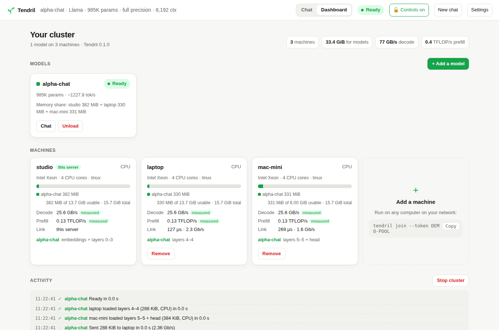
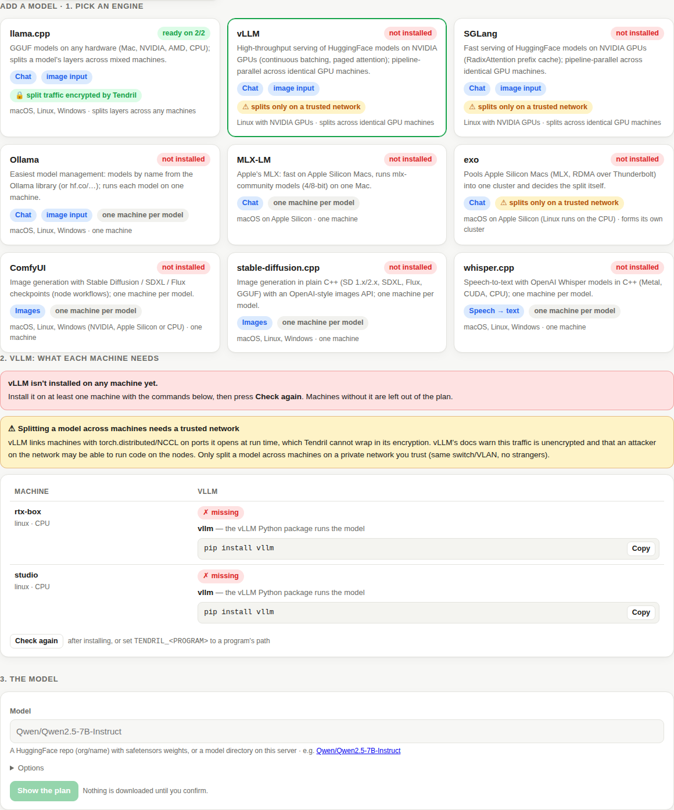
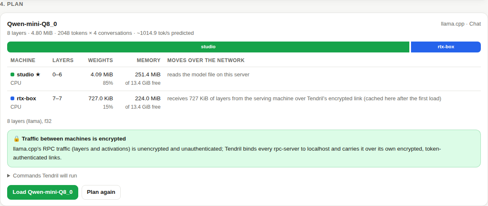

# Tendril

**Run any model across the machines you already have — with the inference engine you choose.**

Tendril finds your machines, plans where a model goes, starts the engine you pick on them
(llama.cpp, vLLM, SGLang, Ollama, MLX-LM, exo, ComfyUI, stable-diffusion.cpp, whisper.cpp),
encrypts the traffic between them, and serves one OpenAI-compatible API: chat (with images
for vision models), image generation and speech-to-text.

```bash
tendril serve                                            # 1. open a cluster (this machine shares its compute)
tendril join --token XXXX-XXXX-XXXX-XXXX                 # 2. on each other machine
tendril load Qwen/Qwen2.5-14B-Instruct-GGUF:Q4_K_M -e llama.cpp   # 3. plan → confirm → run
tendril chat
```

## Install

```bash
git clone https://github.com/hetsaraiya/Tendril && cd Tendril
cargo install --path crates/tendril-cli
tendril engines        # which engines this machine has, and how to install the others
```

Requires Rust 1.82+. Tendril itself runs no models: install at least one engine on each
machine that should compute. `tendril engines` (and the dashboard) show what is missing per
machine with the command that installs it.

## Engines

| Engine | `--engine` | Runs | Across machines | Traffic between machines |
|---|---|---|---|---|
| [llama.cpp](https://github.com/ggml-org/llama.cpp) | `llama.cpp` | GGUF chat models, vision with mmproj; Mac, NVIDIA, AMD, CPU | splits layers across **any** mix of machines (`ggml-rpc-server`) | 🔒 encrypted by Tendril |
| [vLLM](https://github.com/vllm-project/vllm) | `vllm` | HuggingFace models on NVIDIA | pipeline-parallel across identical GPU machines | ⚠ trusted network only |
| [SGLang](https://github.com/sgl-project/sglang) | `sglang` | HuggingFace models on NVIDIA | pipeline-parallel across identical GPU machines | ⚠ trusted network only |
| [Ollama](https://ollama.com) | `ollama` | models by name (`llama3.2:3b`, `hf.co/…`) | one machine per model | — |
| [MLX-LM](https://github.com/ml-explore/mlx-lm) | `mlx` | MLX models on Apple Silicon | one machine per model | — |
| [exo](https://github.com/exo-explore/exo) | `exo` | MLX models; forms its own cluster | the engine splits | ⚠ trusted network only |
| [ComfyUI](https://github.com/comfyanonymous/ComfyUI) | `comfyui` | SD / SDXL / Flux checkpoints → images | one machine per model | — |
| [stable-diffusion.cpp](https://github.com/leejet/stable-diffusion.cpp) | `sd.cpp` | image models in C++ | one machine per model | — |
| [whisper.cpp](https://github.com/ggml-org/whisper.cpp) | `whisper.cpp` | Whisper speech-to-text | one machine per model | — |

Each engine is one Rust type implementing the `Engine` trait
(`crates/tendril-engines`): what it needs installed, what it can run, whether and how it
spans machines, how its traffic is protected, how to start it, and how to talk to it.
Tendril finds programs on `PATH` (or `TENDRIL_<PROGRAM>`, e.g. `TENDRIL_LLAMA_SERVER`),
Python packages in the active Python (`TENDRIL_PYTHON`), and ComfyUI in `~/ComfyUI`
(`TENDRIL_COMFYUI_DIR`).

### How traffic is protected

- **Always:** machines join with the cluster token over an authenticated, encrypted link
  (Noise `NNpsk0`). Engines listen on `127.0.0.1` only; the server reaches every engine's API
  through an encrypted tunnel.
- **llama.cpp splits:** llama.cpp's RPC protocol is unencrypted and unauthenticated, so each
  `ggml-rpc-server` listens on localhost and `llama-server` reaches it through Tendril's
  tunnels. Nobody else on the network can reach it.
- **vLLM, SGLang, exo across machines:** their own traffic (NCCL / torch.distributed, zenoh)
  uses ports chosen at run time that Tendril can't wrap. Tendril shows the risk and loads
  such a split only after you confirm the machines share a private network you trust
  (`--trusted-network`, or the checkbox in the dashboard). On one machine they need nothing.

## Load a model: plan first

`tendril load` (or **Add model** in the dashboard) shows the plan before anything downloads:
which machines take part, which layers and how much of the weights each one holds, the
memory it needs out of what is free, what it downloads or receives, and how the traffic is
protected. Machines without the engine are listed with what to install.

```text
$ tendril load Qwen/Qwen2.5-14B-Instruct-GGUF:Q4_K_M --engine llama.cpp
Plan · Qwen/Qwen2.5-14B-Instruct-GGUF:Q4_K_M with llama.cpp · chat · 48 layers · 8.4 GiB · 8192 ctx × 4
  MACHINE          LAYERS  WEIGHTS   SHARE  MEMORY                   MOVES
  laptop (Metal)   0–17    3.1 GiB   37%    3.9 GiB of 10.7 GiB free  receives 3.1 GiB of layers from the serving machine over Tendril's encrypted link
  studio ★ (Metal) 18–47   5.3 GiB   63%    6.6 GiB of 21.0 GiB free  downloads the GGUF (8.4 GiB) and sends each machine its layers over Tendril's encrypted link
  ✓ ~14.2 tok/s predicted · ★ serves the API

  Load it? [Y/n]
```

(Illustrative numbers.) The plan shown is the plan that runs: the engine class reorders
Tendril's split to how the engine really lays layers out (llama.cpp puts RPC devices first
and the serving machine's GPU last, with exact `--tensor-split` values).

Models come as each engine expects them:

```bash
tendril load bartowski/Llama-3.2-3B-Instruct-GGUF:Q4_K_M -e llama.cpp   # or org/repo/file.gguf, or a .gguf path on the server
tendril load Qwen/Qwen2.5-7B-Instruct -e vllm
tendril load llama3.2:3b -e ollama
tendril load mlx-community/Qwen2.5-7B-Instruct-4bit -e mlx
tendril load stabilityai/sdxl-turbo/sd_xl_turbo_1.0_fp16.safetensors -e sd.cpp
tendril load large-v3-turbo -e whisper.cpp
```

Options: `--quantize`, `--context 32k`, `--concurrency 8`, `--machines a,b`,
`--min-machines 2`, `--trusted-network`, `-y`.

## The dashboard

`tendril serve` prints its address. It shows every machine (chip, backend, memory free and
promised to models, which engines it has), every model and what each of its processes is
doing (downloading, loading, ready, or failed with the engine's output). Controls unlock with
the cluster token: add a model (pick an engine → see per machine what's missing and how to
install it → model → plan → load), unload, remove a machine, stop the cluster.







The **Chat** tab adapts to the model: chat with image attachments for vision models, a
prompt box and size picker for image models, audio upload for speech models.

## API

One OpenAI-compatible API at `http://<server>:8080/v1`, whatever the engine:

| Endpoint | Engines |
|---|---|
| `POST /v1/chat/completions` (streaming, `image_url` parts for vision) | llama.cpp, vLLM, SGLang, Ollama, MLX-LM, exo |
| `POST /v1/completions`, `POST /v1/embeddings` | engines that serve them |
| `POST /v1/images/generations` (`b64_json`) | sd.cpp (passed through), ComfyUI (translated to a workflow; send `workflow` for your own) |
| `POST /v1/audio/transcriptions` (multipart `file`) | whisper.cpp (translated) |
| `GET /v1/models` | all |

`"model"` picks the model when several are loaded. Control endpoints take
`Authorization: Bearer <cluster token>`: `POST /api/plan`, `POST /api/models`
(`{"engine", "model", "quantize"?, "context"?, "concurrency"?, "machines"?, "min_machines"?,
"trusted_network"?, "expect_version"?}`), `POST /api/models/unload`, `POST /api/machines/remove`,
`POST /api/machines/detect` (look for newly installed engines), `POST /api/stop`.
`GET /api/status` and `GET /api/engines` need no token.

**Stopping:** Ctrl+C on the server (or **Stop cluster**) stops every engine, and every joined
machine says why and exits. Ctrl+C on a joined machine makes only that machine leave.

## Planning without running

```bash
tendril plan gemma-2-9b --node air=m4:16 --node mini=m5:16 --link thunderbolt   # would it run, and how?
tendril fit llama-3.1-70b --node studio=m2-ultra:192                             # which quantizations and contexts fit
tendril inspect Qwen/Qwen2.5-7B-Instruct                                         # what a model contains, no download
```

## How the planner works

1. **Inspect** the model: layer count, attention layout (including sliding-window layers
   that cap KV growth), tied embeddings, and — when tensor headers are available — the
   exact bytes of every component.
2. **Budget** each machine honestly. On Apple Silicon the GPU may only wire about ⅔ of RAM
   by default (Tendril tells you how to raise it). A plan fits only when
   `weights + KV cache + activation scratch + transport buffers + runtime + safety margin`
   fits every machine, including load-time peaks. Two 16 GB Macs are not a 32 GB GPU.
3. **Search** every ordered subset of machines and, for each, solve an exact dynamic
   program over all contiguous layer cuts (millions of cuts in milliseconds). A machine
   is left out when including it would slow things down — and Tendril says so.
4. **Predict** decode speed (memory-bandwidth bound: each token streams the stage's
   weights), chunked, pipelined prefill, and the per-token network hop plus the sampled
   token's trip back.
5. **Rank** by goal and **advise**: shortest context that fits, quantizations that fit
   (with quality notes), macOS GPU limits, network upgrades, how much memory to add.

Predictions come from hardware specs (CPUs are measured once per hardware setup); they are
estimates, clearly labelled as such. Each engine's real speed differs.

## Project docs

- [Architecture: crates, the engine trait, deployments, tunnels and security](docs/architecture.md)
